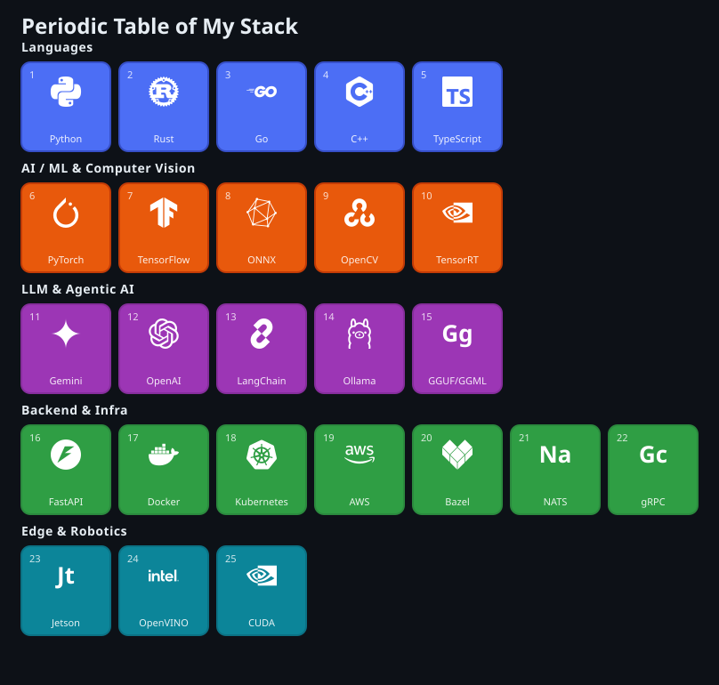

# Hi, I'm Saravana Perumal 👋

### AI Platform Engineer | Computer Vision · Agentic AI & LLMs · Edge & Robotics

I build production AI systems across computer vision, real-time LLM agents, and edge inference —
from model/pipeline work to the infrastructure that deploys it on real hardware.

---

### About Me

- 🤖 AI Platform Engineer at **Machani Robotics** — real-time multimodal agents, edge perception, robotics infrastructure
- 🧠 Deep in the **GGML/GGUF** ecosystem — extending it from LLM-only toward computer vision (rare territory)
- 📈 Solo-built **Vanegam**, a live algorithmic trading platform — async microservices, real-time execution, local-LLM reporting
- ⚙️ Designing **Telemachos** — an offline-first telemetry crate for Rust, built for edge/robotics targets
- 🌱 Always shipping something at the intersection of CV, agents, and real hardware

---

### Tech Stack

---

### Featured Projects

| Project | What it is | Stack |
|---|---|---|
| **[Vanegam](https://github.com/saravanacode/vanegam)** | Live algorithmic trading platform — 4-service microservices, async execution engine, local-LLM performance journaling | `FastAPI` `PostgreSQL` `WebSockets` `Ollama` `Docker` |
| **[GGML YuNet Loader](https://github.com/saravanacode/ggml-yunet)** | From-scratch GGUF/GGML loader for a multi-scale face-detection model — extending GGML past its LLM-only comfort zone | `C++` `GGML` `GGUF` `PyTorch` |
| **[Telemachos](https://github.com/saravanacode/telemachos)** | Offline-first, store-and-forward telemetry crate for Rust, designed for edge/robotics targets | `Rust` `tracing` `OTLP` |
| **[AirPiano](https://github.com/saravanacode/airpiano)** | Gesture-controlled rhythm game — real-time hand tracking mapped to a live synth | `MediaPipe` `Tauri` `Web Audio API` |

*(update the repo links above once each is pushed public — swap in real URLs)*

---

### GitHub Stats

---

📍 Bangalore, Karnataka, India &nbsp;·&nbsp; Open to interesting AI/CV/robotics collaborations

